# Good Morning! · 魔法单词本

面向 **4–6 岁**儿童的英语启蒙拖拽游戏。孩子把单词卡片从底部“魔法单词本”拖到场景道具上，建立“物品 / 动作 — 英语发音”的多模态关联；每步成功后，小人在对应房间做出动作（起床、喝水、刷牙、洗脸、穿衣、穿裤、穿鞋），最后完成出门自检清单。

**这是整个游戏的第一关（早晨动线）**，关卡/房间/步骤全部是数据配置，后续关卡和插入视频都不需要改代码。

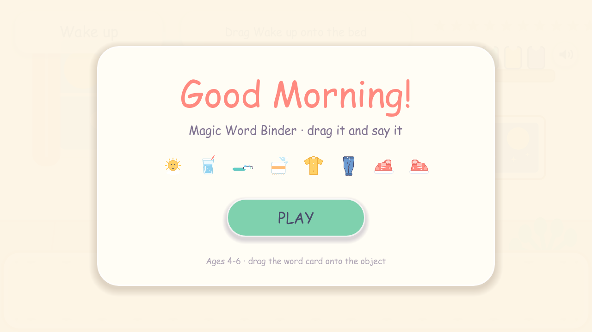

| 卧室：躺在床上（侧脸朝上） | 拖对 Wake up：坐起来 |
| --- | --- |
|  |  |

| 房间转场：人物走出去 | 转场：从另一侧走回来 |
| --- | --- |
| 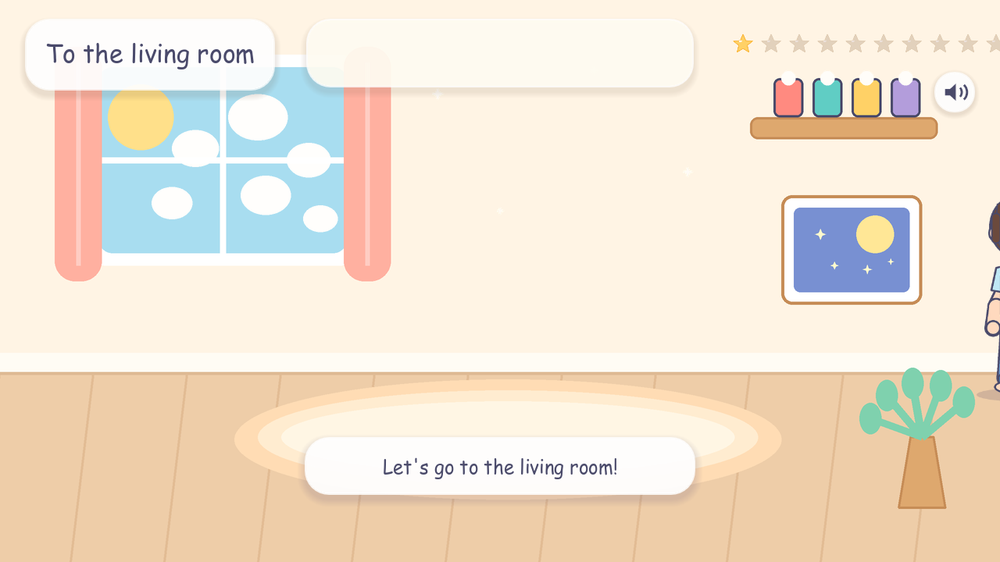 | 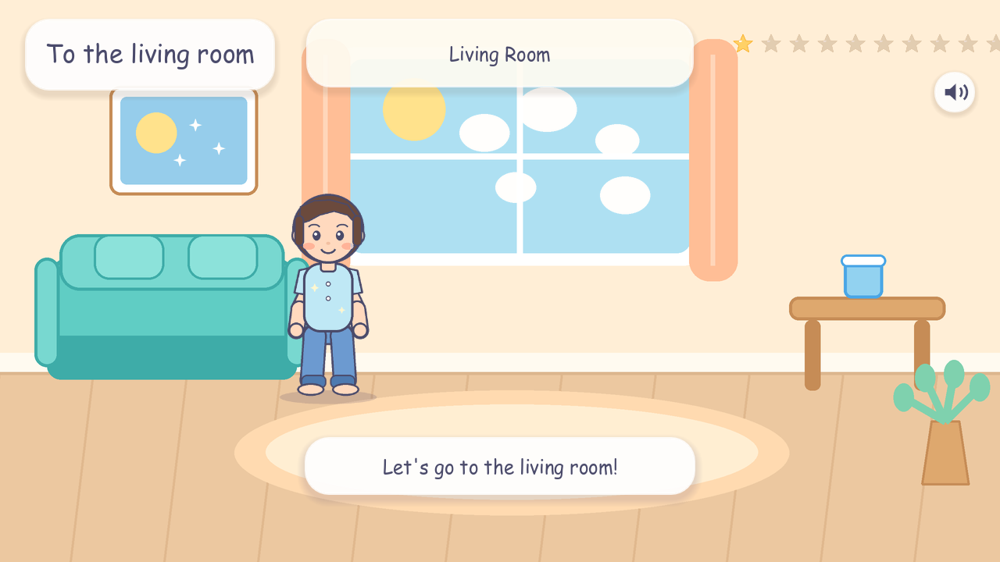 |

| 客厅：喝水 | 洗手间：刷牙 |
| --- | --- |
| 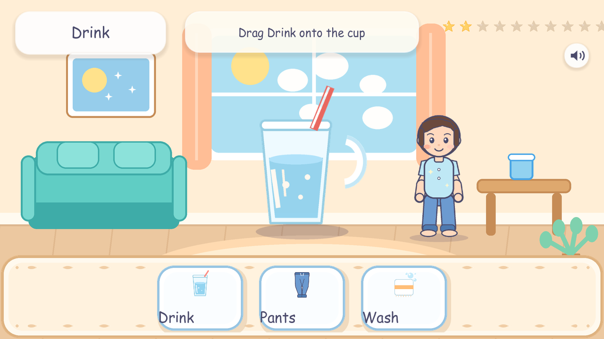 | 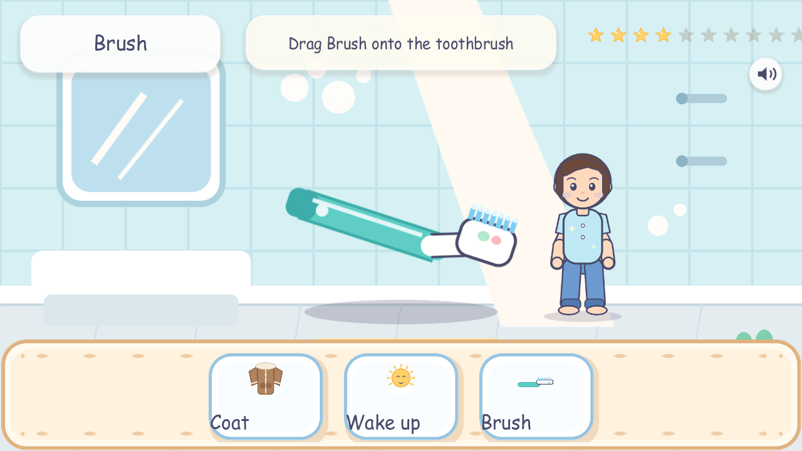 |

| 视频插入点（cutscene） | 卧室：穿裤子 |
| --- | --- |
| 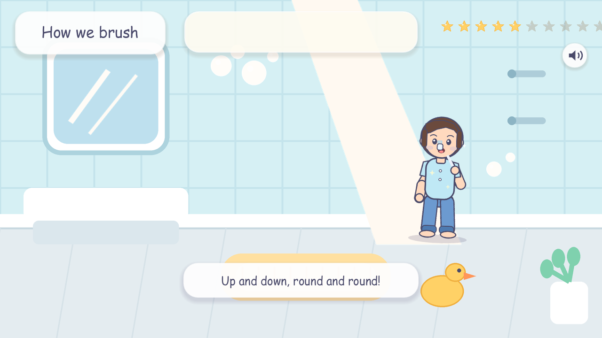 | 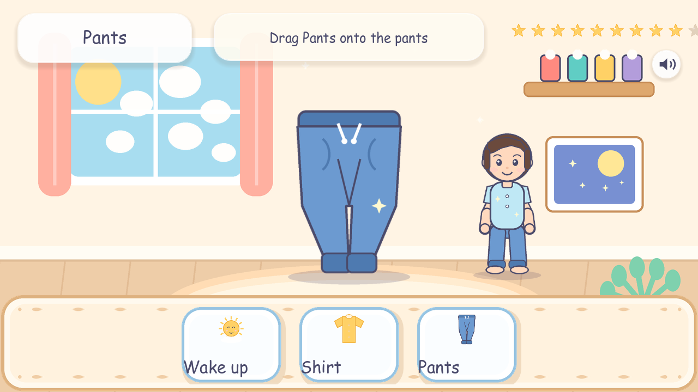 |

| 玄关：左右脚配对 | 出门检查清单（自动换行布局） |
| --- | --- |
| 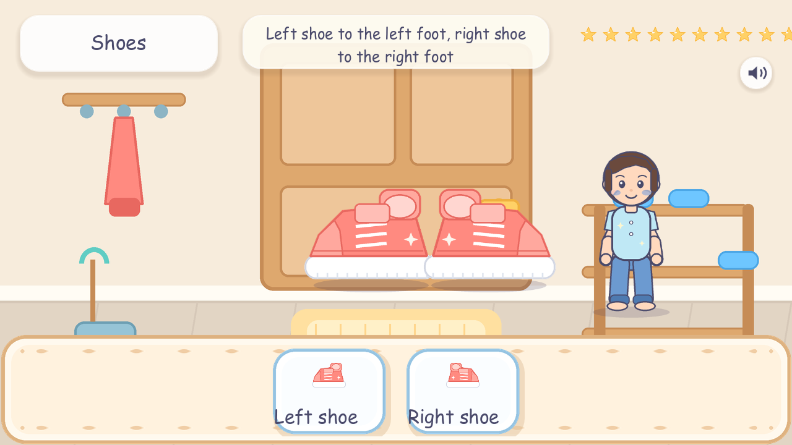 | 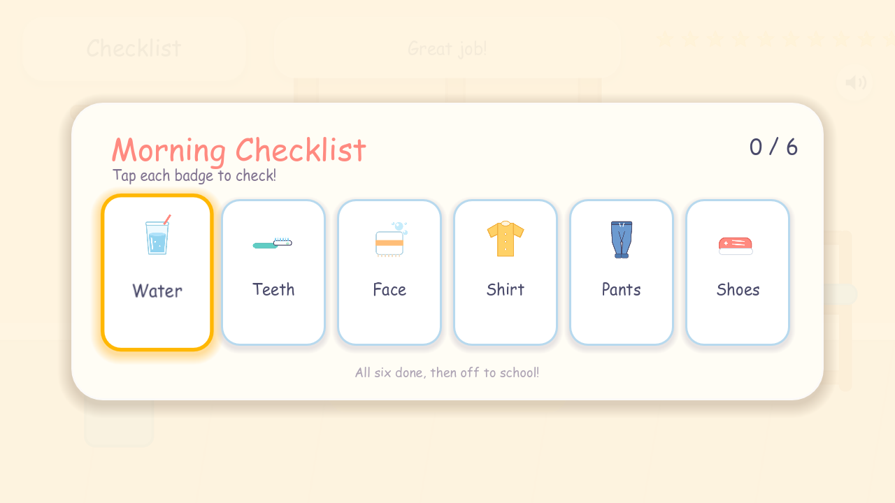 |

| 完成页 | 10 秒无操作：幽灵小手 |
| --- | --- |
| 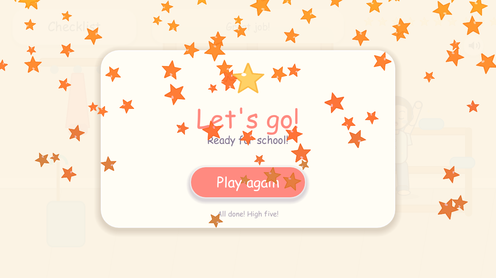 | 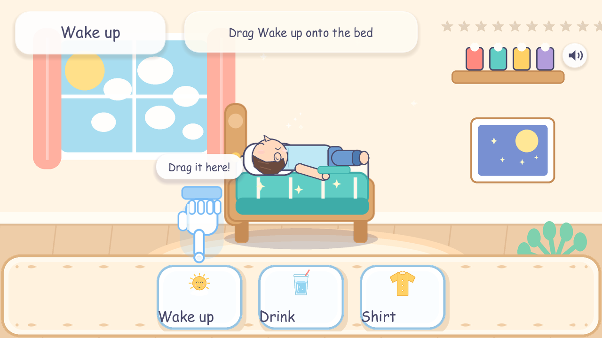 |

> 引擎：Godot **4.3**（GDScript，GL Compatibility 渲染，1280×720 横屏）
> **游戏内全部为英文**（UI、字幕、语音、数据文件），无中文字符。
> 数据驱动：关卡 `data/game.json` + `data/levels/*.json`，房间 `data/rooms.json`，清单 `data/checklist.json`。

---

## 一、已实现功能

### 1. 内容与流程（第 1 关：早晨）

一条完整的**房间动线**，中间可以插动画/视频：

| # | 步骤 | 房间 | 类型 | 内容 |
| --- | --- | --- | --- | --- |
| 1 | 起床 | 卧室 | drag | 拖 `Wake up` 到床上；小人躺床 → 坐起 → 站起 |
| 2 | 去客厅 | → 客厅 | cutscene | 转场动画（可换成视频） |
| 3 | 喝水 | 客厅 | drag | 拖 `Drink` 到水杯；小人举杯咕嘟 |
| 4 | 去洗手间 | → 洗手间 | cutscene | 转场 |
| 5 | 刷牙 | 洗手间 | drag | 拖 `Brush` 到牙刷；小人左右刷牙 |
| 6 | 刷牙示范 | 洗手间 | cutscene | **视频插入点**（`video` 字段） |
| 7 | 洗脸 | 洗手间 | drag | 拖 `Wash` 到毛巾；小人擦脸冒泡泡 |
| 8 | 回卧室 | → 卧室 | cutscene | 转场 |
| 9 | 穿衣 | 卧室 | drag | 拖 `Shirt`；有 `Coat` 干扰项 |
| 10 | 穿裤子 | 卧室 | drag | 拖 `Pants`；小人提裤子 |
| 11 | 去玄关 | → 玄关 | cutscene | 转场 |
| 12 | 穿鞋 | 玄关 | **pair** | 左脚鞋 → 左脚，右脚鞋 → 右脚（左右必须配对） |
| 13 | 出门检查 | 玄关 | checklist | 6 个徽章（水/牙/脸/上衣/裤子/鞋） |

- 每步 2–3 张卡片（1 张正确 + 干扰项），按步骤 id 确定性洗牌。
- 开始页 → 13 步 → 门前清单 → 完成页 → 再玩一次；顶部 13 颗进度星、静音按钮。

### 2. 核心交互（AAC 风格 Word Binder）
- **发起端**：底部常驻单词本，横向排列可拖拽卡片；`_get_drag_data()` 返回 `{type, card_id, word}` 并用 `set_drag_preview()` 生成 **半透明卡片残影**（已验证残影跟随光标、源卡片变淡）。
- **接收端**：`BaseProp`（Control）覆盖道具 **+30%** 热区；`_can_drop_data()` 高亮可接收、`_drop_data()` 判定 `card_id == required_card`，成功/失败分别发射 `matched` / `mismatched` 自定义信号，并修改 `$"../Sprite2D".modulate`（绿 / 红）。
- **成功**：道具变绿 + 弹性放大 + 小人动作动画 + 星星粒子 + 本步 `done` 配音，动作结束后停留约 2.2 秒进入下一步。
- **pair**：两个道具都要匹配；只对一半时提示 “再找一找！One more!”。
- **失败**：道具变红 + 横向摇晃 + 小人缩一下 + `wrong` / 通用 `Oops` 配音，计时器立即重置。
- 点按卡片/道具都会发音；拖动卡片时立即朗读单词。

### 3. 零挫败状态机
- 进入关卡 / 拖拽 / 点击道具 / 拖错 → 重置 **10 秒**空闲计时器。
- 10 秒无操作 → 半透明**幽灵小手**从当前位置用 `Tween` 滑到**正确卡片正上方**，随后上下循环弹跳（`set_loops()`），气泡提示“拖到道具上!”，并播放本关 `timeout` 语音。
- 任意有效交互 / 进入下一关 / 匹配成功 → 立即隐藏小手并重新计时。
- 门前清单有独立的 10 秒提示：超时会播放 `vo_timeout_act6.mp3`，并让下一个未勾选徽章发光/弹跳。
- 已用 `--idletest` 实际等待 10.6 秒验证：小手出现坐标 `(314, 328)`，正好位于正确卡片上方；点按道具后立即隐藏且计时器重置。

### 4. 音频与视觉
- **VO**：`edge-tts` + `en-US-AnaNeural` 生成 **48 条 MP3**：7 个单词（含 Coat 干扰词）+ 5 条通用 UI + 36 条分幕台词（intro / action / done / timeout / 左右刷牙 / 左右穿鞋 / 咕嘟 / 洗脸循环 / 5 个清单徽章 / High-five）；每句按脚本单独设定语速（-15% ~ +5%）。
- **SFX / BGM**：`numpy` 程序化合成 10 个音效（pop、tap、success、error、clear、finish、brush、splash、snap、sparkle）、19.2 秒循环 BGM，以及卧室/浴室两条环境循环（鸟鸣、水滴）。
- **小人**：11 个姿态（站、躺、坐、喝水、刷牙 A/B、洗脸、穿衣、穿鞋、穿鞋后、欢呼），由 `Character` 用 Tween 做动作序列；全部为 `Pillow` 程序化绘制的原创占位图，可替换。
- **美术**：2 张背景、6 个道具、7 个图标（含 Coat）、卡片/面板/星星/幽灵手/声音图标/泡泡。

### 5. 工程结构（4 层解耦）
```
assets/      美术、字体、音频资产池（bgs / props / char / ui / fonts / audio / video）
assets_src/  素材源文件（PSD/AI/音频工程），带 .gdignore，不参与导入
data/        game.json（关卡清单）+ rooms.json（房间）+ levels/*.json（步骤流）+ checklist.json
docs/        ASSET_GUIDE.md 等开发文档
scenes/      Main、BinderUI、WordCard、PropNode、GhostHand、Character、Checklist、Cutscene
core/        main.gd 导演、level_data.gd 关卡加载、cutscene.gd 插片、
             character.gd 小人、checklist.gd 清单、word_card.gd、base_prop.gd、
             binder_ui.gd、ghost_hand.gd、prop_node.gd、ui_kit.gd、audio.gd
tools/       美术/音频/VO/小人生成、资产校验、自动巡演与角色几何检查
```

---

## 二、运行

### 方式 A：Godot 编辑器（推荐）
1. 安装 **Godot 4.3+ Standard**（无需 .NET）。
2. 打开 `project.godot`，按 **F5**。
3. 首次打开会自动导入 `assets/`（约十几秒）。

### 方式 B：命令行
```powershell
# 在项目根目录
& "C:\path\to\Godot_v4.3-stable_win64.exe" --path .
```

### 方式 C：一键脚本（Windows）
```powershell
.\run_game.bat
```
脚本查找 Godot 的顺序（**任意 4.x 版本都可用，不要求文件名带 4.3**）：

1. `.tools\godot\godot_path.txt`（可选，把 Godot 的完整路径写进去，一行一个）；
2. `.tools\godot\Godot*win64.exe`（推荐：把官方 zip 解出来的 exe 丢进这个目录即可，`.tools/` 已在 `.gitignore` 中）；
3. `%ProgramFiles%\Godot`、`%ProgramFiles(x86)%\Godot`、`%LOCALAPPDATA%\Programs\Godot`；
4. `PATH` 里的 `godot` 命令。

> 注意 Windows 解压 zip 的坑：把 `Godot_v4.x-stable_win64.exe` 解压时，若选了“解压到同名文件夹”，会得到一个**以 `.exe` 结尾的目录**，真正的 exe 在里面。脚本会递归扫描 `.tools\godot`，但不会去你的下载目录里翻，所以手动放进来或写 `godot_path.txt` 最省事。
>
> 只想验证“有没有认到引擎”而不启动游戏：`set GMWB_NO_LAUNCH=1` 再运行 `run_game.bat`，它会打印解析到的 Godot 路径后退出。

启动后会保留一个控制台窗口（可最小化），等游戏结束后再关闭；这样游戏进程不会被父进程提前回收，也能直接看到引擎退出码。
脚本还会把 Godot 的 `user://`（日志、着色器缓存）重定向到项目内的 `.godot_userdata\`，避免 `%APPDATA%` 不可写时 Godot 直接以 `0xC0000005` 崩溃。

> 如果双击后没有出现游戏窗口：
> 1. 按 `Alt+Tab` / 看任务栏，找 `Good Morning! - Word Binder (DEBUG)`；
> 2. 运行 `run_game_debug.bat`，它会把 Godot 的完整控制台输出留在窗口里；
> 3. 日志在 `.godot_userdata\Godot\app_userdata\Good Morning! - Word Binder\logs\godot.log`；
> 4. 确认 `.tools\godot\` 下有一个 `Godot*win64.exe`（或已安装 Godot 4.x，且脚本能打印出它的路径）。
>
> 如果 `run_game_debug.bat` 只显示 `Exit code: -1073741819`（即 `0xC0000005`）且没有引擎版本行，这是 Godot 4.3 在 `user://` 目录不可写时触发的崩溃，不是游戏脚本的问题。启动脚本已经把 `APPDATA` 重定向到项目内 `.godot_userdata\`，通常可直接解决；若该目录仍无法创建，脚本会回退到 `%TEMP%\GoodMorningUserData`。

> 自适应：窗口可缩放，`canvas_items + keep` 保证 16:9 平板/桌面都完整显示，不会裁切卡片与道具。

---

## 三、内容结构（这是整个游戏的第一关）

数据分三层，**全部由 JSON 驱动，加关卡 / 加房间 / 插动画都不需要改代码**：

```text
data/game.json                     关卡清单（一个游戏可以挂很多关）
data/rooms.json                    房间表（背景 + 环境音）
data/levels/morning_routine.json   第 1 关的步骤流
data/checklist.json                门前清单
```

### 3.1 关卡文件 = 一串 `steps`

```json
{
  "id": "morning_routine",
  "title": "Good Morning!",
  "title_cn": "早晨的七件事",
  "steps": [
    {"type": "drag",      "room": "bedroom",  "req_card": "card_wake", "prop": {...}, "cards": [...]},
    {"type": "cutscene",  "room": "living",   "video": "res://assets/video/x.mp4", "duration": 2.4},
    {"type": "drag",      "room": "living",   "req_card": "card_drink", ...},
    {"type": "pair",      "room": "entrance", "props": [ {...left}, {...right} ], ...},
    {"type": "checklist", "room": "entrance"}
  ]
}
```

| 步骤类型 | 作用 | 关键字段 |
| --- | --- | --- |
| `drag` | 拖一张卡片到道具 | `prop{img,pos,scale}`、`req_card`、`cards[]`、`action`、`char`、`audio` |
| `pair` | 多个道具各自匹配（左右鞋） | `props[{img,pos,scale,req_card}]`、`cards[]` |
| `cutscene` | **插入动画 / 视频 / 房间转场** | `video`、`poses`、`character_action`、`walk`、`walk_out`、`walk_in_pos`、`duration`、`vo`、`caption`、`skip_after` |
| `checklist` | 出门前徽章自检 | 读取 `data/checklist.json` |

每个 step 还可以带 `room`——进入时自动切换背景与环境音（带 0.32 秒淡入转场）。

### 3.2 房间转场：人物走出去、再从另一侧走回来

`cutscene` 加上 `walk` 就会播放走路转场：

```json
{
  "id": "goto_living", "type": "cutscene", "room": "living",
  "title": "To the living room", "vo": "res://assets/audio/vo/vo_goto_living.mp3",
  "caption": "Let's go to the living room!",
  "duration": 3.4,
  "walk": true,
  "walk_out": "right",
  "walk_in_pos": [420, 505]
}
```

执行顺序：

1. 小人从当前位置**走到屏幕右侧**（带上下起伏步态 + 朝向翻转）；
2. 人物完全出画后，**在老背景上换成新房间的背景与环境音**（`_on_cutscene_midpoint`）；
3. 小人**从左侧重新走进来**，走到 `walk_in_pos`；
4. 播 `vo` / 字幕，`duration` 到点（或点击）进入下一步。

`walk_out` 可以是 `"right"` 或 `"left"`，人物会从相反方向走回。实测位移（goto_living）：

```text
x: 930 → 1420（走出右侧） → -137（从左侧出现） → 420（走到位）
```

### 3.3 插入动画 / 视频（刷牙视频、穿衣视频）

`cutscene` 按优先级取素材：

1. **`video`**：`res://assets/video/xxx.mp4`（或 `.ogv`）存在时，用 `VideoStreamPlayer` 全屏播放；
2. **`poses`**：一组 `{pose, pos, scale}`，小人会走过去 / 切姿态；
3. **`character_action`**：直接播放某个动作（`brush` / `shirt` / `pants` …）。

没有素材时不会报错，只是退回 `poses`。所以在步骤流里先写好位置，等视频做好直接丢文件进去即可：

```json
{"id": "brush_video", "type": "cutscene", "room": "bathroom",
 "caption": "Up and down, round and round!",
 "duration": 4.0, "skip_after": 1.2,
 "vo": "res://assets/audio/vo/vo_brush_video.mp3",
 "video": "res://assets/video/brush_teeth.mp4",
 "character_action": "brush"}
```

孩子点一下屏幕就能跳过；`skip_after` 秒后出现 “Tap to continue” 提示。

> Godot 4.3 的 `VideoStreamPlayer` 原生只播 **OGV/Theora**；MP4 需要 WebM/OGV 转换，或装插件。把视频转成 `.ogv` 最省事（`ffmpeg -i in.mp4 -c:v libtheora -c:a libvorbis out.ogv`），文件名写进 `video` 即可。

### 3.4 新增一关

1. 在 `data/levels/` 下复制一个关卡文件，改 `id` / `title` / `steps`；
2. 在 `data/game.json` 的 `levels` 数组里加上路径；
3. 需要新房间就在 `data/rooms.json` 加一项（背景图 + 环境音）。

不需要改任何 GDScript。加载时会校验：未知步骤类型、缺 `req_card`、缺 `cards`、pair 少于两个道具、未知房间——都会打印错误并跳过该步，不会崩。

### 3.5 字段速查

| 字段 | 说明 |
| --- | --- |
| `title` / `title_en` | 顶部标题（中文小字 + 英文大字） |
| `hint` | 顶部中文提示 |
| `room` | `bedroom` / `living` / `bathroom` / `entrance` |
| `prop.pos` / `prop.scale` | 道具中心坐标（1280×720）与缩放 |
| `req_card` | 正确卡片 id，必须在 `cards` 中 |
| `cards[]` | `id`、`text`、`img`、`vo` |
| `action` | 小人动作：`wake` / `drink` / `brush` / `wash` / `shirt` / `pants` / `shoes` |
| `char` | 小人站位、缩放；起床步额外有 `start_pose:"lying"`、`start_pos`、`start_scale` |
| `audio` | 分幕语音：`intro` / `action` / `done` / `timeout`，以及 `left` / `right` / `all` / `sip` / `loop` / `wrong` |
| `ambience` | 该房间的环境循环音 |

---

## 四、核心实现位置

| 白皮书要求 | 文件 | 说明 |
| --- | --- | --- |
| `_get_drag_data` + 半透明残影 | `core/word_card.gd` | 拖拽时 `modulate.a = 0.35` 淡化源卡片；`_build_drag_preview()` 复制卡片外观并 `set_drag_preview()`；拖拽数据为字典 |
| `_can_drop_data` / `_drop_data` + 信号 + `$"../Sprite2D"` 变色 | `core/base_prop.gd` | `matched` / `mismatched` 自定义信号；绿/红 modulate；错误摇晃；+30% 热区 |
| 步骤流导演 | `core/main.gd` | `drag` / `pair` / `cutscene` / `checklist` 四种步骤；房间切换；10s 空闲计时器；进度星 |
| 数据加载与校验 | `core/level_data.gd` | 读 `game.json` → 每个关卡文件 → 清洗步骤，坏数据跳过 |
| 插入动画 / 视频 | `core/cutscene.gd` + `scenes/Cutscene.tscn` | video → poses → character_action 三级回退；点击跳过；字幕气泡 |
| 小人动画 | `core/character.gd` | 11 个姿态 + Tween 序列：躺→坐→站、举杯、左右刷牙、擦脸、穿衣、穿裤、穿鞋 |
| 门前清单 | `core/checklist.gd` | 6 个徽章，`HFlowContainer` **自动换行**布局；独立 10s 提示、逐条语音、全部打勾后 High-five + 完成页 |
| 4 层架构 | `assets/` `data/` `scenes/` `core/` | 代码不含任何具体单词或关卡 |

其他细节：
- `core/audio.gd` 作为 Autoload `Audio`，VO / SFX / BGM / Ambience 分播放器，静音全局生效，WAV 运行时设置循环。
- `core/ui_kit.gd` 统一圆角面板 / 按钮 / 字体主题（`assets/ui/kid_theme.tres` 通过 `gui/theme/custom` 全局生效，包括 CanvasLayer 下的 UI）。
- 拖拽接收区为道具的矩形外接框 ×1.3，并自动避开顶部 UI 与底部单词本。


---

## 五、资产：替换与重新生成

### 5.1 换成你自己的素材（推荐先读）

完整规格、构图调参、新增关卡/单词、音频替换、字体替换、AI 生图工作流都在
**[docs/ASSET_GUIDE.md](docs/ASSET_GUIDE.md)**。

最短路径：

1. 新图导出为 **PNG（RGBA，透明背景）**，按推荐尺寸覆盖同名文件；
2. 双击 **`reimport_assets.bat`** 让 Godot 重新导入（或切回编辑器窗口）；
3. 运行 `run_game.bat`；位置/大小不合适就改 `data/levels/morning_routine.json` 的 `prop_pos` / `prop_scale`。

| 类型 | 路径 | 推荐尺寸 | 关键要求 |
| --- | --- | --- | --- |
| 背景 | `assets/bgs/*.png` | 1280×720（16:9） | 不要画道具/底部面板 |
| 道具 | `assets/props/prop_*.png` | 512×512 | 透明背景、物体居中 |
| 卡片图标 | `assets/props/icon_*.png` | 256×256 | 透明背景、留白一致 |
| 小人 | `assets/char/char_*.png` | 512×512 | 透明背景，站立姿态脚底对齐 y≈468 |
| 卡片/面板 | `assets/ui/card.png`、`panel.png` | 256×256 / 512×256 | 九宫格，注意 patch margin |
| 幽灵手 | `assets/ui/ghost_hand.png` | 180×220 | 透明背景、食指朝下 |
| 音频 | `assets/audio/**` | WAV/MP3/OGG | 路径见 `data/levels/morning_routine.json` / `checklist.json` / `core/audio.gd` |
| 字体 | `assets/fonts/*.ttf` | — | 改 `assets/ui/kid_theme.tres` |

- 换文件名/换一整套主题：改 `data/levels/morning_routine.json` 的 `res://` 路径或 `.tscn` 的 `ext_resource` 即可，不用改代码。
- 源文件（PSD/AI/Procreate/音频工程）放 `assets_src/`，该目录带 `.gdignore`，Godot 不会导入。
- ⚠️ **替换后不要运行 `tools/gen_art.py` / `tools/gen_audio.py`**，它们会覆盖你的素材。

### 5.2 重新生成占位素材（会覆盖当前文件）

仓库里的占位素材由脚本生成，改风格/回退时使用：

```powershell
# 1) 美术（Pillow）—— 覆盖 assets/bgs、assets/props、assets/ui 的 PNG
python tools/gen_art.py

# 2) 小人 11 个姿态（Pillow）—— 覆盖 assets/char
python tools/gen_character.py

# 3) 音效 + BGM + 环境音（numpy，44.1kHz WAV）
python tools/gen_audio.py

# 4) 配音（edge-tts，需要联网；含 36 条分幕台词）
python -m pip install edge-tts
python tools/vo_pipeline.py            # 只补缺失
python tools/vo_pipeline.py --force    # 全部重生成
```

`vo_pipeline.py` 自动从 `data/levels/morning_routine.json` 读取卡片列表，并内置全部 Act 1–6 的分幕台词与语速；新增单词卡片后重新运行即可生成对应 VO。

### 5.3 AI 生图建议

按白皮书提示词 `flat 2D game asset, cartoon style for kids, solid white background` 生成 512×512 物体图，抠成透明 PNG 后同名覆盖 `assets/props/*.png`，无需改代码。背景单独生成 16:9、不带道具。细节见 [docs/ASSET_GUIDE.md](docs/ASSET_GUIDE.md)。

---

## 六、自测与验收

```powershell
# 资产完整性：房间 + 关卡步骤 + 清单 + 小人姿态 + 全部分幕语音
& godot --headless --path . --script res://tools/validate_project.gd

# 自动巡演：开始页 → 拖错 → 幽灵手 → 真实鼠标拖拽 → 13 步（含转场/清单）→ 完成页
& godot --path . --audio-driver Dummy -- --autotest --shots="C:/tmp/shots"

# 零挫败计时器：真实等待 10 秒后截图
& godot --path . --audio-driver Dummy -- --autotest --idletest --shots="C:/tmp/shots"

# 动画姿态序列：逐步打印 lying→sit→stand / brush_a↔brush_b / shoes→stand_shoes
& godot --path . --audio-driver Dummy -- --autotest --animtest

# 小人几何自检（无肩膀凸起、有裤子、躺姿头身相连）
python tools/check_character.py
```

`tools/autopilot.gd` 会用 `Input.parse_input_event` 合成完整的按下—移动—释放流程，并按窗口缩放换算坐标，因此 Godot 原生拖放链路（`_get_drag_data` → `_can_drop_data` → `_drop_data`）在每次自测中都会被真实验证，而不是只调用内部方法。

最近一次验收结果：
- `levels: 1  rooms: 4`，`checked: 135 errors: 0`（1 条预期 WARN：刷牙视频文件尚未提供，自动回退到姿态动画）
- 完整 13 步走通：卧室 → 客厅 → 洗手间 → 卧室 → 玄关 → 清单 → 完成页
- 房间转场走路实测（goto_living）：`x: 930 → 1420 → -137 → 420`（走出右侧 → 换背景 → 从左侧走回）
- 真实鼠标拖拽成功（`[drag] dragging=true` 数据正确）
- 房间确实换了：4 个房间截图平均色各不相同，客厅有沙发（teal 1916px）、玄关有木门（3680px）、洗手间有瓷砖（32509px）
- 小人几何自检 0 问题：站立 `slivers=0`（无第二肩膀）、裤子像素在腰下 92 行、躺姿**侧脸朝上**（头发重心在头心下方 33px、鼻子上方 79px 肤色）
- 清单布局实测：panel `1076×426` 居中，6 个徽章**一行放下**（`rows=1 overflow=0`），再增加会自动换行
- 门前清单 6 个徽章全部打勾 → `finale=true`；"再玩一次"回到第 1 步

---

## 七、已知边界 / 下一步

- **字体授权**：当前只保留 `assets/fonts/comic.ttf`（Comic Sans MS，Windows 自带），用于英文 UI；中文字体 `deng.ttf` 已随本次"去中文"移除。**对外发布前请替换为 OFL 字体**（如 Fredoka / Comic Neue），并更新 `assets/ui/kid_theme.tres`。
- 美术为程序化占位图，风格统一但精细度低于 AI 生图；直接替换同名资产即可。
- **小人动画是“姿态切换 + Tween”**（11 张 512×512 姿态图），不是骨骼动画；替换时保持站立姿态脚底在 y≈468、身体居中。需要骨骼/逐帧动画时可把 `Character.tscn` 换成 `AnimatedSprite2D`，数据字段和导演逻辑可保留。
- **视频**：`cutscene` 已支持 `video` 字段，但 Godot 4.3 原生只播 OGV/Theora；MP4 需先转 `.ogv`（`ffmpeg -i in.mp4 -c:v libtheora -c:a libvorbis out.ogv`）。文件缺失时自动回退到 `poses` 姿态动画，不会崩。
- 门前清单是独立的 6 徽章点击关，不复用拖拽判定；语音/图标都在 `data/checklist.json`，徽章数量可随意增减（自动换行）。
- 目前是单机单会话：无存档、无家长门、无难度分级、无麦克风跟读评分。
- 音频共 60 条 VO + 10 个 SFX + BGM + 2 条环境音；语音合成适合 MVP，正式版建议母语儿童配音演员录制并做响度标准化。
- 尚未提供导出模板；安装 Godot Export Templates 后可在 `Project → Export` 直接导出 Windows / Android。

---

## 八、许可

- 代码、`data/levels/morning_routine.json`、程序化美术与合成音频：可随项目自由使用。
- 配音由 Microsoft Edge TTS 生成，用于 MVP 演示；正式发行请确认服务条款并替换为自有录音。
- 字体见上文授权提示。
