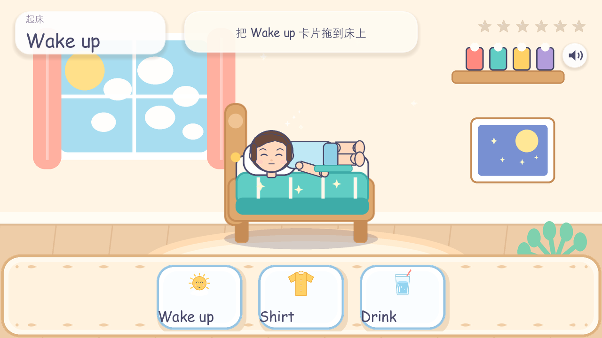
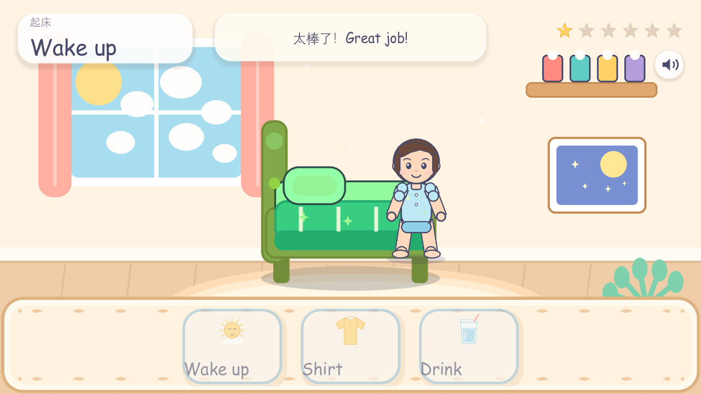
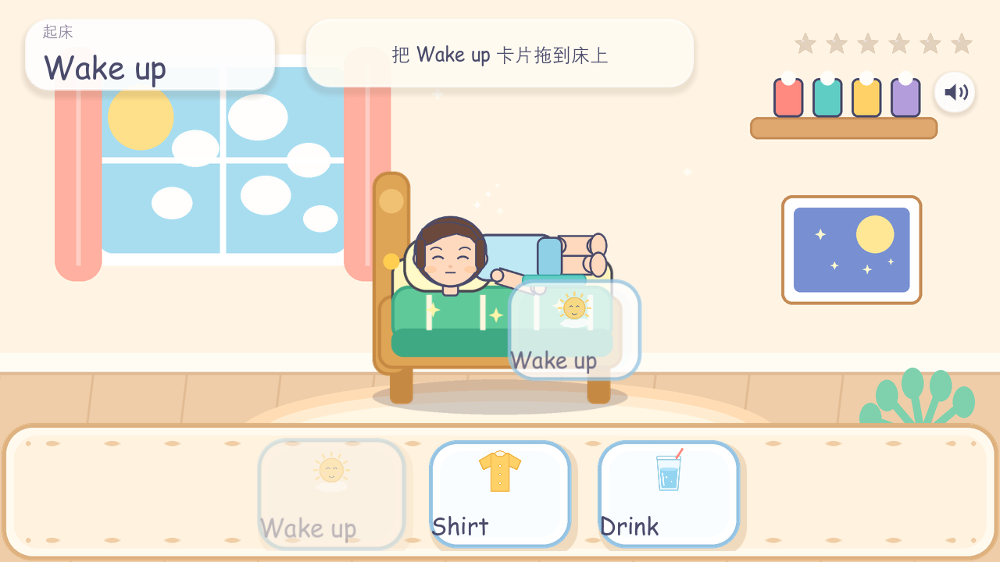
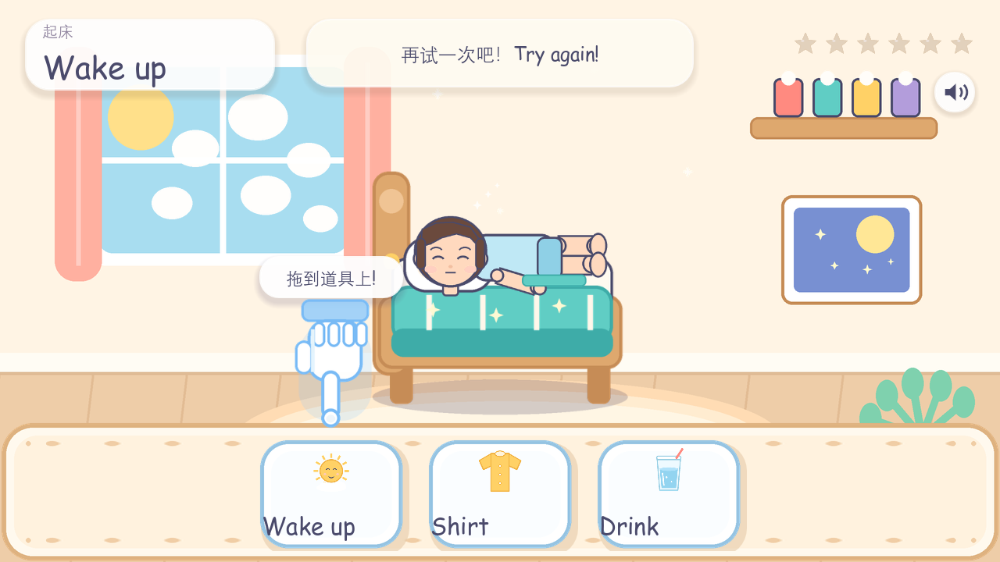
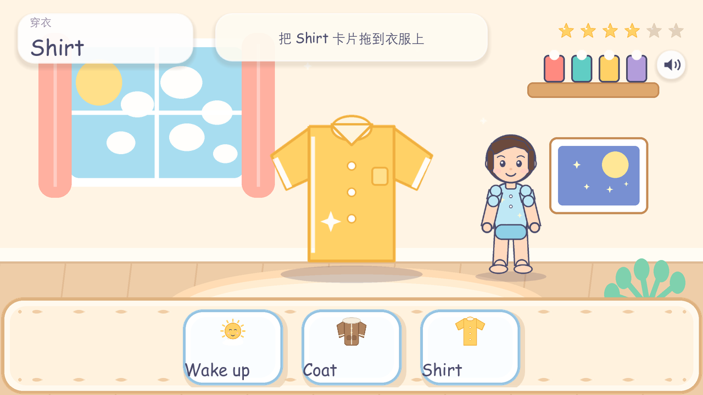
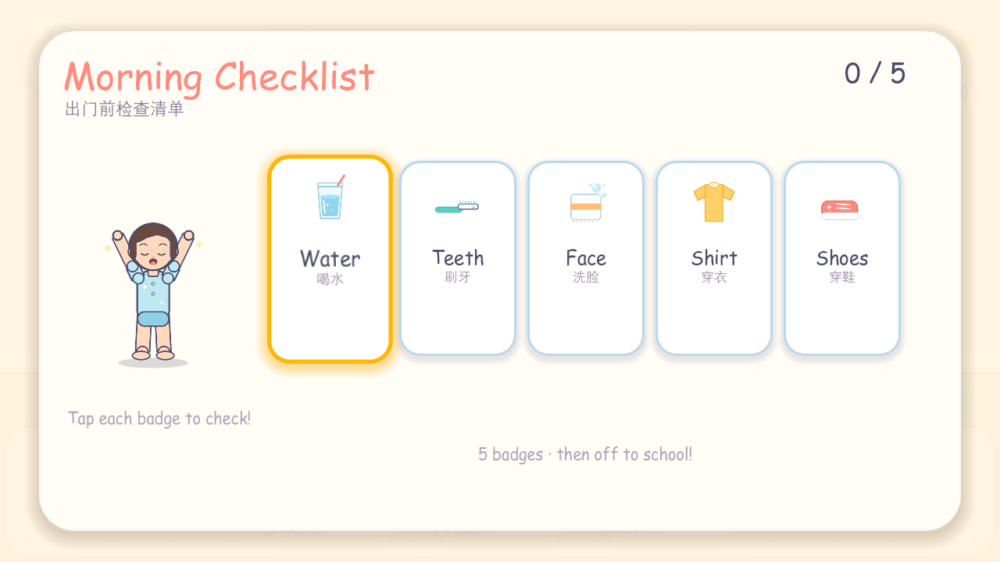

# Good Morning! · 魔法单词本

面向 **4–6 岁**儿童的英语启蒙拖拽游戏 MVP。孩子把单词卡片从底部“魔法单词本”拖到场景道具上，建立“物品 / 动作 — 英语发音”的多模态关联；每关成功后，场景里的小人会做出对应动作（起床、喝水、刷牙、洗脸、穿衣、穿鞋），最后完成门前自检清单。


| 起床前：小人还躺在床上 | 拖对 Wake up 后：慢慢坐起来 |
| --- | --- |
|  |  |

| 拖拽中（半透明残影） | 零挫败提示（幽灵小手） |
| --- | --- |
|  |  |

| 穿衣关（含 Coat 干扰项） | 门前自检清单 |
| --- | --- |
|  |  |


> 引擎：Godot **4.3**（GDScript，GL Compatibility 渲染，1280×720 横屏）
> 项目完全数据驱动：新增一关只需要改 `data/story.json`；清单内容在 `data/checklist.json`。

---

## 一、已实现功能（对照白皮书）

### 1. 内容与流程
- 6 个拖拽场景 + 1 个门前清单（Act 6）：
  1. **Act 1 起床** — 拖 `Wake up` 到床上；小人躺床 → 坐起 → 站起
  2. **Act 1.5 喝水** — 拖 `Drink` 到水杯上；小人举杯、咕嘟咕嘟喝两口
  3. **Act 2 刷牙** — 拖 `Brush` 到牙刷上；小人左右刷牙，刷毛/水声同步
  4. **Act 3 洗脸** — 拖 `Wash` 到毛巾上；小人用毛巾擦脸，冒泡泡
  5. **Act 4 穿衣** — 拖 `Shirt` 到衣服上；有 `Coat` 干扰项，拖错会播放“Too hot! Not the heavy coat!”
  6. **Act 5 穿鞋** — 拖 `Shoes` 到鞋子上；小人弯腰穿鞋、左右各“啪”一下
  7. **Act 6 门前清单** — 依次点 5 个徽章（水/牙/脸/衣/鞋），全部打勾后播放 High-five 完成音
- 每关 3 张卡片（1 张正确 + 2 张干扰项），按关卡 id 确定性洗牌，避免孩子记住位置而不是记住单词。
- 开始页 → 6 关 → 门前清单 → 完成页 → 再玩一次；顶部 6 颗进度星、静音按钮。

### 2. 核心交互（AAC 风格 Word Binder）
- **发起端**：底部常驻单词本，横向 3 张可拖拽卡片；`_get_drag_data()` 返回 `{type, card_id, word}` 并用 `set_drag_preview()` 生成 **半透明卡片残影**（已验证残影跟随光标、源卡片变淡）。
- **接收端**：`BaseProp`（Control）覆盖道具 **+30%** 热区；`_can_drop_data()` 高亮可接收、`_drop_data()` 判定 `card_id == required_card`，成功/失败分别发射 `matched` / `mismatched` 自定义信号，并修改 `$"../Sprite2D".modulate`（绿 / 红）。
- **成功**：道具变绿 + 弹性放大 + 小人动作动画 + 星星粒子 + 本关 `done` 配音，动作结束后再停留约 2.2 秒进入下一关。
- **失败**：道具变红 + 横向摇晃 + 小人缩一下 + 本关 `wrong` / 通用 `Oops` 配音，计时器立即重置。
- 点按卡片/道具都会发音；拖动卡片时立即朗读单词（把“拖”这个动作本身变成听力输入）。

### 3. 零挫败状态机
- 进入关卡 / 拖拽 / 点击道具 / 拖错 → 重置 **10 秒**空闲计时器。
- 10 秒无操作 → 半透明**幽灵小手**从当前位置用 `Tween` 滑到**正确卡片正上方**，随后上下循环弹跳（`set_loops()`），气泡提示“拖到道具上!”，并播放本关 `timeout` 语音。
- 任意有效交互 / 进入下一关 / 匹配成功 → 立即隐藏小手并重新计时。
- 门前清单有独立的 10 秒提示：超时会播放 `vo_timeout_act6.mp3`，并让下一个未勾选徽章发光/弹跳。
- 已用 `--idletest` 实际等待 10.6 秒验证：小手出现坐标 `(314, 328)`，正好位于正确卡片上方；点按道具后立即隐藏且计时器重置。

### 4. 音频与视觉
- **VO**：`edge-tts` + `en-US-AnaNeural` 生成 **48 条 MP3**：7 个单词（含 Coat 干扰词）+ 5 条通用 UI + 36 条分幕台词（intro / action / done / timeout / 左右刷牙 / 左右穿鞋 / 咕嘟 / 洗脸循环 / 5 个清单徽章 / High-five）；每句按脚本单独设定语速（-15% ~ +5%）。
- **SFX / BGM**：`numpy` 程序化合成 10 个音效（pop、tap、success、error、clear、finish、brush、splash、snap、sparkle）、19.2 秒循环 BGM，以及卧室/浴室两条环境循环（鸟鸣、水滴）。
- **小人**：11 个姿态（站、躺、坐、喝水、刷牙 A/B、洗脸、穿衣、穿鞋、穿鞋后、欢呼），由 `Character` 用 Tween 做动作序列；全部为 `Pillow` 程序化绘制的原创占位图，可替换。
- **美术**：2 张背景、6 个道具、7 个图标（含 Coat）、卡片/面板/星星/幽灵手/声音图标/泡泡。

### 5. 工程结构（4 层解耦）
```
assets/      美术、字体、音频资产池（bgs / props / char / ui / fonts / audio）
assets_src/  素材源文件（PSD/AI/音频工程），带 .gdignore，不参与导入
data/        story.json（6 关）+ checklist.json（门前清单）
docs/        ASSET_GUIDE.md 等开发文档
scenes/      Main、BinderUI、WordCard、PropNode、GhostHand、Character、Checklist
core/        Main.gd 导演、Character.gd、Checklist.gd、WordCard.gd、BaseProp.gd、
             BinderUI.gd、GhostHand.gd、PropNode.gd、StoryData.gd、UiKit.gd、audio.gd
tools/       美术/音频/VO/小人生成、资产校验、自动巡演与动画测试
```

---

## 二、运行

### 方式 A：Godot 编辑器（推荐）
1. 安装 **Godot 4.3+ Standard**（无需 .NET）。
2. 打开 `project.godot`，按 **F5**。
3. 首次打开会自动导入 `assets/`（约十几秒）。

### 方式 B：命令行
```powershell
# 在项目根目录
& "C:\path\to\Godot_v4.3-stable_win64.exe" --path .
```

### 方式 C：一键脚本（Windows）
```powershell
.\run_game.bat
```
脚本会依次查找 `.tools\godot\Godot_v4.3-stable_win64.exe`、`godot` 命令或常见安装路径。
启动后会保留一个控制台窗口（可最小化），等游戏结束后再关闭；这样游戏进程不会被父进程提前回收，也能直接看到引擎退出码。
脚本还会把 Godot 的 `user://`（日志、着色器缓存）重定向到项目内的 `.godot_userdata\`，避免 `%APPDATA%` 不可写时 Godot 直接以 `0xC0000005` 崩溃。

> 如果双击后没有出现游戏窗口：
> 1. 按 `Alt+Tab` / 看任务栏，找 `Good Morning! - Word Binder (DEBUG)`；
> 2. 运行 `run_game_debug.bat`，它会把 Godot 的完整控制台输出留在窗口里；
> 3. 日志在 `.godot_userdata\Godot\app_userdata\Good Morning! - Word Binder\logs\godot.log`；
> 4. 确认 `.tools\godot\Godot_v4.3-stable_win64.exe` 存在（或已安装 Godot 4.3+）。
>
> 如果 `run_game_debug.bat` 只显示 `Exit code: -1073741819`（即 `0xC0000005`）且没有引擎版本行，这是 Godot 4.3 在 `user://` 目录不可写时触发的崩溃，不是游戏脚本的问题。启动脚本已经把 `APPDATA` 重定向到项目内 `.godot_userdata\`，通常可直接解决；若该目录仍无法创建，脚本会回退到 `%TEMP%\GoodMorningUserData`。

> 自适应：窗口可缩放，`canvas_items + keep` 保证 16:9 平板/桌面都完整显示，不会裁切卡片与道具。

---

## 三、数据格式 `data/story.json`

顶层是关卡数组，新增关卡**不需要改代码**：

```json
{
  "id": "level_brush",
  "title": "刷牙",
  "title_en": "Brush",
  "hint": "把 Brush 卡片拖到牙刷上",
  "bg_img": "res://assets/bgs/bg_bathroom.png",
  "prop_img": "res://assets/props/prop_brush.png",
  "prop_pos": [640, 340],
  "prop_scale": 1.12,
  "req_card": "card_brush",
  "action": "brush",
  "char": {"pos": [930, 505], "scale": 0.62},
  "ambience": "res://assets/audio/ambience/bathroom.wav",
  "audio": {
    "intro": "res://assets/audio/vo/vo_act2_intro.mp3",
    "left": "res://assets/audio/vo/vo_act2_brush_l.mp3",
    "right": "res://assets/audio/vo/vo_act2_brush_r.mp3",
    "all": "res://assets/audio/vo/vo_act2_brush_all.mp3",
    "done": "res://assets/audio/vo/vo_act2_done.mp3",
    "timeout": "res://assets/audio/vo/vo_timeout_act2.mp3"
  },
  "cards": [
    {"id": "card_brush", "text": "Brush",  "img": "res://assets/props/icon_brush.png", "vo": "res://assets/audio/vo/card_brush.mp3"},
    {"id": "card_wake",  "text": "Wake up","img": "res://assets/props/icon_wake.png",  "vo": "res://assets/audio/vo/card_wake.mp3"}
  ]
}
```

| 字段 | 说明 |
| --- | --- |
| `title` / `title_en` | 顶部关卡名（中文小字 + 英文大字） |
| `hint` | 顶部中文提示（拖错后临时换成“再试一次”，2.4s 后恢复） |
| `bg_img` / `prop_img` | 背景图 / 道具图，缺失时校验会直接报错 |
| `prop_pos` | 道具中心坐标（设计分辨率 1280×720） |
| `prop_scale` | 在自适应尺寸基础上的额外缩放 |
| `req_card` | 正确卡片 id，必须出现在 `cards` 中 |
| `cards[]` | `id`、`text`、`img`、`vo`；每关建议 3 张 |
| `action` | 小人的成功动作：`wake` / `drink` / `brush` / `wash` / `shirt` / `shoes` |
| `char` | 小人站位与起始姿态；起床关额外有 `start_pose:"lying"`、`start_pos`、`start_scale` |
| `audio` | 分幕语音：`intro` / `action` / `done` / `timeout`，以及 `left` / `right` / `all` / `sip` / `loop` / `wrong` 等事件 |
| `ambience` | 该关的环境循环音（卧室/浴室） |
| 可选 `id` | 用于洗牌种子；缺省自动生成 |

加载时会做完整校验（字段、重复 id、卡片图片、`req_card` 是否存在），坏关卡会被跳过并打印错误，不会崩游戏。**门前清单**由 `data/checklist.json` 配置（5 个徽章、图标、每条语音）。

---

## 四、核心实现位置

| 白皮书要求 | 文件 | 说明 |
| --- | --- | --- |
| `_get_drag_data` + 半透明残影 | `core/word_card.gd` | 拖拽时 `modulate.a = 0.35` 淡化源卡片；`_build_drag_preview()` 复制卡片外观并 `set_drag_preview()`；拖拽数据为字典 |
| `_can_drop_data` / `_drop_data` + 信号 + `$"../Sprite2D"` 变色 | `core/base_prop.gd` | `matched` / `mismatched` 自定义信号；绿/红 modulate；错误摇晃；+30% 热区 |
| 读取 `story.json`、过关切景、10s Timer + Tween 幽灵手 | `core/main.gd` + `core/ghost_hand.gd` | `StoryData` 解析；`DONE_HOLD = 2.2`；`IDLE_HINT_DELAY = 10.0`；`Tween` 移动 + 循环弹跳；`_reset_idle()` 统一重置 |
| 小人动画 | `core/character.gd` + `scenes/Character.tscn` | 11 个姿态 + Tween 序列：躺→坐→站、举杯、左右刷牙、擦脸、穿衣、穿鞋；动作内按时间点播放分幕语音/音效 |
| 门前清单 | `core/checklist.gd` + `scenes/Checklist.tscn` | 5 个徽章、独立 10s 提示、逐条 badge 语音、全部打勾后 High-five + 完成页 |
| 4 层架构 | `assets/` `data/` `scenes/` `core/` | 代码不含任何具体单词，新增关卡只改 JSON |

其他细节：
- `core/audio.gd` 作为 Autoload `Audio`，VO / SFX / BGM / Ambience 分播放器，静音全局生效，WAV 运行时设置循环。
- `core/ui_kit.gd` 统一圆角面板 / 按钮 / 字体主题（`assets/ui/kid_theme.tres` 通过 `gui/theme/custom` 全局生效，包括 CanvasLayer 下的 UI）。
- 拖拽接收区为圆形道具的矩形外接框 ×1.3，对 4 岁孩子的手指足够宽容。

---

## 五、资产：替换与重新生成

### 5.1 换成你自己的素材（推荐先读）

完整规格、构图调参、新增关卡/单词、音频替换、字体替换、AI 生图工作流都在
**[docs/ASSET_GUIDE.md](docs/ASSET_GUIDE.md)**。

最短路径：

1. 新图导出为 **PNG（RGBA，透明背景）**，按推荐尺寸覆盖同名文件；
2. 双击 **`reimport_assets.bat`** 让 Godot 重新导入（或切回编辑器窗口）；
3. 运行 `run_game.bat`；位置/大小不合适就改 `story.json` 的 `prop_pos` / `prop_scale`。

| 类型 | 路径 | 推荐尺寸 | 关键要求 |
| --- | --- | --- | --- |
| 背景 | `assets/bgs/*.png` | 1280×720（16:9） | 不要画道具/底部面板 |
| 道具 | `assets/props/prop_*.png` | 512×512 | 透明背景、物体居中 |
| 卡片图标 | `assets/props/icon_*.png` | 256×256 | 透明背景、留白一致 |
| 小人 | `assets/char/char_*.png` | 512×512 | 透明背景，站立姿态脚底对齐 y≈468 |
| 卡片/面板 | `assets/ui/card.png`、`panel.png` | 256×256 / 512×256 | 九宫格，注意 patch margin |
| 幽灵手 | `assets/ui/ghost_hand.png` | 180×220 | 透明背景、食指朝下 |
| 音频 | `assets/audio/**` | WAV/MP3/OGG | 路径见 `story.json` / `checklist.json` / `core/audio.gd` |
| 字体 | `assets/fonts/*.ttf` | — | 改 `assets/ui/kid_theme.tres` |

- 换文件名/换一整套主题：改 `story.json` 的 `res://` 路径或 `.tscn` 的 `ext_resource` 即可，不用改代码。
- 源文件（PSD/AI/Procreate/音频工程）放 `assets_src/`，该目录带 `.gdignore`，Godot 不会导入。
- ⚠️ **替换后不要运行 `tools/gen_art.py` / `tools/gen_audio.py`**，它们会覆盖你的素材。

### 5.2 重新生成占位素材（会覆盖当前文件）

仓库里的占位素材由脚本生成，改风格/回退时使用：

```powershell
# 1) 美术（Pillow）—— 覆盖 assets/bgs、assets/props、assets/ui 的 PNG
python tools/gen_art.py

# 2) 小人 11 个姿态（Pillow）—— 覆盖 assets/char
python tools/gen_character.py

# 3) 音效 + BGM + 环境音（numpy，44.1kHz WAV）
python tools/gen_audio.py

# 4) 配音（edge-tts，需要联网；含 36 条分幕台词）
python -m pip install edge-tts
python tools/vo_pipeline.py            # 只补缺失
python tools/vo_pipeline.py --force    # 全部重生成
```

`vo_pipeline.py` 自动从 `story.json` 读取卡片列表，并内置全部 Act 1–6 的分幕台词与语速；新增单词卡片后重新运行即可生成对应 VO。

### 5.3 AI 生图建议

按白皮书提示词 `flat 2D game asset, cartoon style for kids, solid white background` 生成 512×512 物体图，抠成透明 PNG 后同名覆盖 `assets/props/*.png`，无需改代码。背景单独生成 16:9、不带道具。细节见 [docs/ASSET_GUIDE.md](docs/ASSET_GUIDE.md)。

---

## 六、自测与验收

```powershell
# 资产完整性：6 关 + 清单 + 小人姿态 + 全部分幕语音，共 125 个引用
& godot --headless --path . --script res://tools/validate_project.gd

# 自动巡演：开始页 → 拖错 → 幽灵手 → 真实鼠标拖拽 → 小人动画 → 6 关 → 门前清单 → 完成页
& godot --path . --audio-driver Dummy -- --autotest --shots="C:/tmp/shots"

# 零挫败计时器：真实等待 10 秒后截图
& godot --path . --audio-driver Dummy -- --autotest --idletest --shots="C:/tmp/shots"

# 动画姿态序列：逐关打印 lying→sit→stand / brush_a↔brush_b / shoes→stand_shoes
& godot --path . --audio-driver Dummy -- --autotest --animtest
```

`tools/autopilot.gd` 会用 `Input.parse_input_event` 合成完整的按下—移动—释放流程，并按窗口缩放换算坐标，因此 Godot 原生拖放链路（`_get_drag_data` → `_can_drop_data` → `_drop_data`）在每次自测中都会被真实验证，而不是只调用内部方法。

最近一次验收结果：
- `levels: 6`, `checked: 125`, `errors: 0`
- 开始页 **PLAY 按钮真实点击**后进入第 1 关；完成页“再玩一次”点击后回到第 1 关
- 真实拖拽成功过关（无 fallback 警告）
- 动画姿态验证：`lying → sit → stand`、`drink → stand`、`brush_a/brush_b`、`wash`、`shirt`、`shoes → stand_shoes`
- 10s 空闲：`ghost visible=true rect=(314,328,220,250)` → 点按后 `ghost=false timer≈9.6s`
- 6 关全部通过 → 门前清单 5 个徽章全部打勾 → 完成页 `finale=true`

---

## 七、已知边界 / 下一步

- **字体授权**：当前字体为 Windows 自带 `comic.ttf`（Comic Sans MS）与 `deng.ttf`（等线），仅适合本机 MVP 开发；**对外发布前请替换为 OFL 字体**（如 Fredoka / Comic Neue + 站酷快乐体 / Noto Sans SC），并更新 `assets/ui/kid_theme.tres`。外网字体 CDN 在本机被网络策略拦截，因此未内置。
- 美术为程序化占位图，风格统一但精细度低于 AI 生图；直接替换同名资产即可。
- **小人动画是“姿态切换 + Tween”**（11 张 512×512 姿态图），不是骨骼动画；替换时保持站立姿态脚底在 y≈468、身体居中，动作序列会自动适配。需要骨骼/逐帧动画时可把 `Character.tscn` 换成 `AnimatedSprite2D`，数据字段和导演逻辑可保留。
- 门前清单是独立的 5 徽章点击关，不复用拖拽判定；语音/图标都在 `data/checklist.json`。
- 目前是单机单会话：无存档、无家长门、无难度分级、无麦克风跟读评分。
- 音频共 48 条 VO + 10 个 SFX + BGM + 2 条环境音；语音合成适合 MVP，正式版建议母语儿童配音演员录制并做响度标准化。
- 尚未提供导出模板；安装 Godot Export Templates 后可在 `Project → Export` 直接导出 Windows / Android。

---

## 八、许可

- 代码、`story.json`、程序化美术与合成音频：可随项目自由使用。
- 配音由 Microsoft Edge TTS 生成，用于 MVP 演示；正式发行请确认服务条款并替换为自有录音。
- 字体见上文授权提示。
